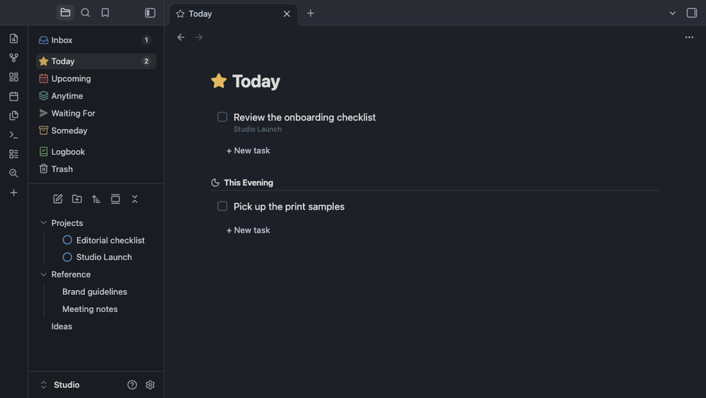

<h1 align="center">ThingsMD for Obsidian</h1>

<strong>Keep your notes and tasks together.</strong>

  
  

## Features

Turn any note into a project, capture tasks as they come up, and plan your day in Today and Upcoming. Every task is a Markdown file in your vault.

- Keep tasks beside project notes.
- Start dates, deadlines, recurring tasks and checklists.
- Capture tasks from the command palette, with a global desktop shortcut.
- See calendar events alongside tasks in Today and Upcoming.
- Convert existing Markdown checkboxes, including Tasks Emoji and Dataview formats, into ThingsMD tasks.

## Feedback and contributions

Ideas, bug reports, and feature requests are welcome in [GitHub Issues](https://github.com/kotylevskiy/thingsmd/issues). I maintain the code myself and don’t accept code contributions.

For bug reports, include your ThingsMD and Obsidian versions, your operating system, and the steps to reproduce the issue.

## Thanks to Cultured Code

ThingsMD is inspired by [Things](https://culturedcode.com/things/), Cultured Code’s personal task manager for Apple devices and one of my favorite ways to put GTD into practice. I brought ideas from their beautifully designed app into Obsidian, where I already keep my notes. If you enjoy ThingsMD, consider supporting the Cultured Code team by buying the original app.

ThingsMD is an independently developed plugin, unaffiliated with Cultured Code.

If you’d like to support my work on ThingsMD, please star this repository.
